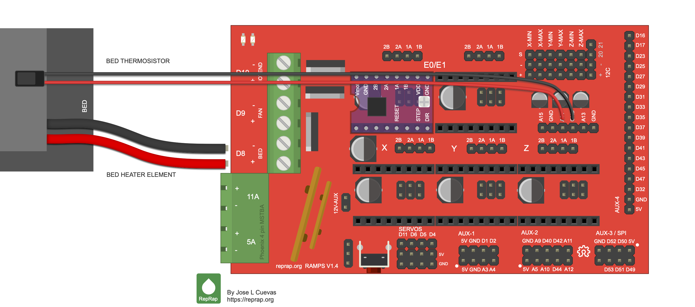

# Fichet safe robot — build and operating manual

> **Revision 2026-10-18.1** · key turner v2: 5:1 printed gears (2026-10-18.1); gear-shaft on a tapered hex with an M3 screw (2026-10-17.2); key driver on the RAMPS E0 socket; UART pigtail · log: `docs/revisions.md`

For Paul. Covers the robot as of **revision 2026-10-18.1**: dial unit v3, key
turner **v2** (5:1 gears, §1.5), wiring with all four drivers on the RAMPS and
the UART pigtail (`control/wiring.md`), firmware **0.8** (PR #58; the command
reference is `control/firmware/README.md`). Correction (2026-10-18): this line
still said revision 2026-10-08.2, key turner v1 and firmware 0.4.

**Status:** nothing has run on hardware yet. The first time through, follow
the bench bring-up (`control/bringup.md`) instead of section 5. It builds
and tests the electronics one stage at a time, and its results fill in the
values that `config.h` still guesses. Every step here that rests on an
unchecked fact says **VERIFY** or **ASSUMPTION**.

**This manual is the procedure; the detailed docs are the reference.** If
the two ever disagree, the reference wins. Tell me, and I'll fix the
manual:

| Topic | Reference |
|---|---|
| Housings, print and fit history | `docs/housing_decisions.md` |
| Parts and orders | `docs/bom.md` |
| Wiring, pin map, currents, power order | `control/wiring.md` |
| Firmware commands and log lines | `control/firmware/README.md` |
| Values not yet measured | `control/firmware/safe_robot/config.h` |
| First power-up and tuning | `control/bringup.md` |
| How the robot works; open questions | `control/sequence.md` |

## Contents

0. [Read first: safety rules](#0-read-first-safety-rules)
1. [Mechanical assembly](#1-mechanical-assembly)
2. [Electrical assembly](#2-electrical-assembly)
3. [Building the software](#3-building-the-software)
4. [Loading the software onto the Mega](#4-loading-the-software-onto-the-mega)
5. [Operating and monitoring](#5-operating-and-monitoring)
6. [Quick reference](#6-quick-reference)

---

## 0. Read first: safety rules

1. **Plug or unplug anything with 12 V off.** That means every motor (the
   key motor cable included) and the drivers. A driver cut off from its
   supply while its motor turns can be damaged (TMC2209 datasheet §3).
2. **Power order:** USB first, then 12 V. To switch off: 12 V first, then USB.
3. **Emergency stop: pull the 12 V plug.** Typing `!` in the logger stops the
   current move and switches all drivers off. The button pauses a run after
   the current attempt.
4. **Keep forces low.** The lock has a relocker ("délateur") that blocks it
   for good if it's forced (`control/lock_research.md`). The firmware limits
   current and stops on stall, so never raise currents above what
   `control/bringup.md` sets.
5. **Fingers out of the gears** while 12 V is on.
6. **Fit drivers the right way round.** Match EN / DIR / VM / GND on the
   driver to the RAMPS silkscreen. A reversed driver is destroyed (BTT
   manual, safety note 1).

---

## 1. Mechanical assembly

There are two units:
- **Dial unit**: three motors turn the three dial plugs through 14T/28T
  gears. Each plug is on a spring-loaded shaft running in two 608 bearings.
  The Mega and RAMPS sit on a deck at the back.
- **Key turner** (v2, revision 2026-10-18.1): one motor 45 mm left of the
  key turns a 60T gear on the key axis through a 12T pinion (5:1). A printed
  cap slides over the key's bow; its tongue sits in a groove in the gear's
  underside.

Both hold to the door with 22 mm rubber-coated M4 pot magnets: 6 on the dial
unit, 3 on the key turner. Design history: `docs/housing_decisions.md`.
Renders (drawn before the magnet change): `cad/renders/dial_unit_v2_section.png`,
`cad/renders/dial_unit_v2_door_view.png`,
`cad/renders/key_turner_v2_overview.png`, `cad/renders/key_turner_v2_drivetrain.png` (frame hidden).

### 1.1 What to print

Print from the per-part STLs in `cad/`. Material and orientation are from
the print notes in `cad/dial_unit_housing.scad` (end of file) and
`cad/key_turner_housing.scad` (end of file).

| STL | Part | Qty | Material | Bed side |
|---|---|---|---|---|
| `dial_front_assembly.stl` | dial front plate: 6 magnet holes, 3 bearing bosses, 3 legs, pointer tab | 1 | PETG | door face |
| `dial_motor_sled.stl` | motor sled + 3 deck legs, with the 3 gear inspection windows (rev 2026-10-11.1) | 1 | PETG | inner face (spring pockets, countersinks); legs up |
| `insert_coupon.stl` | optional: 3 insert posts, drawn 4.37 / 4.45 / 4.53 mm, should print ~4.25 / 4.33 / 4.41 (1 / 2 / 3 notches) (rev 2026-10-12.1) | 1 | PETG | flat base down |
| `electronics_deck.stl` | deck v3.2: 3 M3 insert posts + 1 rest post for the Mega, 3 access holes, button beside its wire hole, barrel cradle by the RAMPS power terminal (rev 2026-10-13.1) | 1 | PETG | underside (motor side) down, as exported; posts up |
| `board_spacers.stl` | 9 spacers for between the RAMPS and the Mega: 3 each of 8.4 / 8.8 / 9.2 mm (1 / 2 / 3 notches) | 1 plate | PETG | flat |
| `taper_hex_coupon.stl` | **print first** (rev 2026-10-17.2): 3 gear hubs with the tapered hex bore drawn 0.0 / 0.1 / 0.2 mm over (1 / 2 / 3 rim notches), each with the gear's back wall, countersink and pocket; 3 shaft tails. Test: §1.3 step 4 | 1 plate | plain PETG | as exported: hubs pocket face down, tails journal end down (brim) |
| `dial_shafts_5mm.stl` (or `dial_shafts_7mm.stl`) | 3 dial shafts: T2 plug + journal + tapered hex tail with an M3 pilot (rev 2026-10-17.2). Can print before the coupon result: only the gears' bore depends on it | 1 plate | **plain PETG** | **plug tip down**, tail up, as exported, **with a brim** (it stands on ~27 mm²). The 7 mm plug can't be pushed back far enough for the unit to sit flat until it seats (`docs/decisions.md`) |
| `dial_gears.stl` | 3 dial gears (28T, tapered hex bore, back wall with the M3 countersink, front boss, 1 mm spring pocket) (rev 2026-10-17.2). **After the coupon**: I set the bore from it | 1 plate | **plain PETG** | gear rear (pocket) face down. **Elephant-foot compensation on**, or the bottom layer of the teeth binds |
| `dial_drivetrain.stl` | the same on one plate: 3 gears, 3 shafts (5 mm), 3 pinions | 1 plate | pinions **PETG-CF**; the rest plain PETG | as above; pinion hub down. **Elephant-foot compensation on** |
| `magnet_retainers.stl` | 10 retainer discs (9 needed) | 1 plate | PETG | flat |
| `key_turner_base.stl` | key-turner base + 4 legs, 3 magnet seats (v2, rev 2026-10-18.1) | 1 | PETG | door face |
| `key_turner_motor_plate.stl` | key motor plate + bearing boss (v2) | 1 | PETG | **motor face (plate top) down**, boss up, as exported. Elephant-foot compensation on (the bearing pocket opens on the bed) |
| `key_turner_shaft.stl` | key shaft: 60T gear, cap groove in its underside, spacer, journal, M3 pilot (v2) | 1 | **plain PETG** | groove face down, as exported. **Elephant-foot compensation on** (teeth on the bed) |
| `key_turner_pinion.stl` | 12T pinion, D-bore (v2) | 1 | **PETG-CF** | hub end down. **Elephant-foot compensation on** |
| `key_turner_washer.stl` | washer on the top bearing (v2) | 1 | plain PETG | flat (countersink up) |
| `key_turner_cap.stl` | slotted cap (unchanged: the one you have stays) | 1 | **PETG-CF** | slot mouth. **Elephant-foot compensation on** |

PETG-CF needs the hardened (tungsten carbide) hotend.

**Slicer:** Bambu Studio's default settings for the H2D, which is what
you've used so far (Paul, 2026-10-06). Turn on elephant-foot compensation
where the table says so.

**Don't print:**
- `dial_unit_housing.stl` and `key_turner_housing.stl`: whole-unit layouts
  that mix PETG and PETG-CF parts;
- `standoff_screw_fit_test.stl`, `printed_thread_test.stl` and
  `tube_socket_test_key_set.stl`: old test pieces;
- `Fichet_robot.3mf` and `dial_unit_housing.3mf`: pre-v2 geometry.

**Already printed and passed** (`docs/housing_decisions.md`):
- the door-pattern test (2026-10-05: "plate fits the door perfectly and all
  three dial turners turn easily");
- the key fit test (2026-10-06: the cap slides on and turns the key to its
  stop);
- the Mega base coupon (2026-10-04: 3 of 4 screws go in; 3 are enough).
  No longer relevant: from revision 2026-10-12.1 the base plate isn't used.

**Magnet holes:** the dial front assembly you already printed (22.4 mm
holes) stays in use, with a 2-layer wrap strip on each magnet (§1.3a). The
current STLs have 21.7 mm holes (no strips needed), and that includes the v2
key-turner base (revision 2026-10-18.1), a new print. Print the retainers if
you haven't yet.

### 1.2 Hardware

| Item | Dial unit | Key turner | Status |
|---|---|---|---|
| 608 bearings (8 × 22 × 7) | 6 (2 per dial) | 2 (key shaft, v2) | on hand |
| Compression springs ≤ 8 mm OD, ~18–20 mm free, solid < 10 mm | 3 | — | ordered: QUARKZMAN 0.5 × 7 × 20 mm, 304 stainless, arriving 2026-10-07 (Paul). Count the coils on arrival |
| M3 × 10 countersunk, hex socket (the length includes the head) | 15: 12 motor screws + 3 gear-shafts (rev 2026-10-17.2, self-tapping into the shaft) | 5: 4 motor screws + 1 key shaft (v2, through the washer, self-tapping) | on hand (kit has 55) |
| M6 countersunk self-tapping, 16 mm | 6 | 4 (v2) | on hand. On the key turner, 16 mm works better than the 20 mm the CAD notes listed (Paul, 2026-10-06) |
| M3 brass heat-set inserts (HANGLIFE, 4.2 mm OD, ~5 mm) | 3 | — | on hand |
| M3 nylon screws, **16–20 mm** (Mega + RAMPS to the posts) | 3 | — | on hand (Paul). 16 mm gives 4 mm in the insert; longer than 21 mm would bottom in the post |
| M3 × 3 or × 4 **grub** screws (pinion / hub), optional | 3 | 1 | optional. **Never a cap screw**: its head would hit the gear |
| 22 mm rubber pot magnets, M4 back (Wukong) | 6 | 3 | ordered |
| M4 screws for the magnets | 6 | 3 | the ones in the magnet pack, if any. Otherwise **pan, button or socket head — not countersunk** (the retainer is flat). Length: see §1.3a. Any head up to 9 mm across and 6 mm tall clears the other parts on both units (CAD check, 2026-10-07) |
| Motors 17HE19-2004S | 3 | 1 | on hand (+1 spare) |

### 1.3 Checks before the big parts

1. **Magnets** (`docs/housing_decisions.md`, 2026-10-06):
   1. Measure one magnet's diameter, height and thread depth. If they're
      not 22 mm and 6 mm, tell me before printing: the holes are sized from
      the listing.
   2. **Pull test:** stick one magnet on the door and pull *sideways*
      (along the door) with the luggage scale. **If it slips under about
      0.8 kg**, the units need more magnets or a floor leg before the robot
      runs.

   Send me the three measurements and the slip force.
2. **Springs:** count the coils, and check the spring closes to under 10 mm.
3. **First M6 into a printed leg: drive it by hand**, not with a power
   driver, and check the leg doesn't crack. The legs have ~3.3 mm of wall
   around the 5.4 mm pilot (`docs/bom.md`).
4. **Gear-shaft taper coupon** (`taper_hex_coupon.stl`, rev 2026-10-17.2).
   It tells me how big to draw the gears' bore. Hubs are marked by the
   notches on their rim (1, 2, 3 = bore drawn 0.0 / 0.1 / 0.2 mm over).
   1. Stand a tail on the bench, journal end down. Push hub 1 onto it,
      pocket side up, firmly by hand. Does it turn or rock on the hex at
      all? Measure the height from the bench to the hub's top face
      (drawn: **14.5 mm**). Is there still a gap between the hub's
      underside and the tail's step (drawn 1 mm)?
   2. Pull it off and do the same with hubs 2 and 3 on the same tail.
   3. Then put each hub on its own tail with an M3 × 10 countersunk, by
      hand, **snug, not tight**. Does the screw bite and hold without
      stripping? Is the head flush with the pocket floor? Any play now?
      Height again. Any crack in the tail?
   4. On one of them: back the screw out two turns and press its head
      (thumb, or a tap with the screwdriver handle). Does the hub come
      off?

   Send me, for each hub: play by hand (yes/no), height by hand, gap
   (yes/no), height with the screw, play with the screw, head flush; and
   whether the hub came off in step 4.

### 1.3a Fitting the door magnets (both units)

How it works: each magnet sits in a **through hole** in the plate. On the
plate's inner face a raised **seat ring** (29 mm across) stands around each
hole. A flat printed **retainer disc** (27 mm, 3 mm thick) lies on the ring,
and an M4 screw through the retainer into the magnet's threaded back holds
the magnet up against it. The ring's top sets the depth, so the rubber ends
up 0.2 mm proud of the door face. On the door, the pull goes magnet →
screw → retainer → ring (`common_mounts.scad`, `rmag_*`). The dial front
plate has 6, the key-turner base 3.

**Measure first** (one magnet, calipers):
- **Diameter D.** Measured 21.5 mm (Paul, 2026-10-07). The holes are now
  **21.7 mm**, chosen from the fit-test strip (snug at 21.8, worked in at
  21.7): the rubber grips, so the magnet can't slide out of the inner side.
- **Height H: measured 6.0–6.1 mm, back flush, no boss** (Paul,
  2026-10-07). The rubber stands 0.2–0.3 mm proud: fine. For reference, the
  rule: the magnet's back must be
  level with the ring top (5.8 mm above the door face), so the rubber stands
  H − 5.8 proud. 5.9–6.3 mm is fine (0.1–0.5 proud). Under 5.9 the rubber
  would sit flush or below the plate; over 6.3 the dial plugs sit too
  shallow in the stars. Either way, tell me before fitting: it's one number
  in the CAD and a reprint.
- **Thread depth T** (depth rod into the threaded hole).
- **Screw length** = 3 (retainer) + T − 0.5, rounded **down** to a length
  you have. It must not bottom in the hole, or it stops before it clamps.
  Example: T = 4 → 6.5 → use M4 × 6.

**Before you start:**
- Work on a wooden or plastic table, no steel within ~20 cm. Keep the
  magnets apart: they snap together hard and pinch fingers.
- Look at every seat ring top. It sets the depth, so it must be flat:
  trim any string or blob with a blade. Trim any elephant's foot inside the
  hole at the door face too: the magnet has to go in from that side.
- Check the retainers: the screw should pass through the 4.5 mm hole freely.

**Which plates you have:**
- **Plates printed before 2026-10-07 (22.4 mm holes; the ones in use):**
  wrap each magnet's side once with a **2-layer wrap strip**
  (`cad/magnet_wrap_strips.stl`, 69 × 5 mm × 0.4 mm, PLA; Paul: "the
  2-layer version is perfect"). Wrap it round the middle of the magnet's
  side, ends overlapping, then follow the steps below. The strip goes into
  the hole with the magnet.
- **Plates reprinted from the current STLs (21.7 mm holes):** no strip.
  The hole grips the rubber directly.

Nine strips cover both units (6 + 3); print a couple of spares.

**Steps (per plate).** The hole grips the magnet, so its depth is set by
how far you press it in. The table sets it for you:
1. Lay the plate **inner face down** on the table, so the seat-ring tops sit
   flat on it.
2. From the door side, press a magnet into a hole, **threaded back first**,
   until its back stops on the table. Its back is now level with the ring
   top, and the rubber stands just proud of the door face. Press straight;
   a thumb is usually enough. If it's very stiff, press with a flat block of
   wood over the rubber.
3. Repeat for every hole, then turn the plate over (inner face up).
4. Lay a retainer on each ring, centred on the thread. It rests on the ring
   and on the magnet's back together.
5. Start the M4 screw by hand, then snug it with a screwdriver until the
   retainer can't turn. **Snug, not tight**: the retainer is PETG and the
   thread is in the magnet. No thread-locker (some attack plastic).
6. **Check:**
   - Every retainer sits flat on its ring, no gap.
   - Put the plate door face down on the table and slide a sheet of
     printer paper under its edge between two magnets: it should go under
     (the plate rests on the magnets, not on its face). Do it all round.
   - Turn the plate on its side and shake it gently: nothing moves.
     **Correction (2026-10-07):** an earlier version said a magnet moving
     inward was fine. It wasn't: in the old 22.4 mm holes the 21.5 mm
     magnets and their retainers fell out of the inner side when the unit
     was off the door (Paul). That's why the holes are now 21.7 mm.
7. **Order:** on the dial unit, fit the magnets before anything else (they're
   under the sled). On the key turner, before the motor plate goes on.

**Pull test (once, before the robot runs; §1.3 item 1):**
1. One magnet with its screw part-way in. Tie a loop of string round the
   screw under its head.
2. Stick the magnet flat on the door where the units go.
3. Hook the luggage scale in the loop and pull **along** the door face
   (sideways, not away from it), slowly, until it slides. Note the peak.
4. Three times, plus once pulling straight down. Send me all four readings.
   The units need ~0.8 kg sideways per magnet (1.5 kg dial unit on 6, with
   ~3× margin, `docs/housing_decisions.md` 2026-10-06). Below that, more
   magnets or a floor leg.

**Taking a unit off the door:** pull it straight off, peeling from one edge
if the magnets hold hard. Don't slide it: the dial plugs are in the stars
(§4, shutting down).

### 1.4 Dial unit

**ASSUMPTION: the order below is derived from the CAD.** The repo has no
written assembly order for the dial unit (the pointer to one in
`dial_unit_housing.scad` leads nowhere). Two things fix the order:
- the motor screws go in from the sled's inner face, so the motors must be
  on the sled before it's joined to the front;
- the magnets sit under the sled's outline, so they go in first.

Tell me if a different order works better, and I'll record it.

1. **Magnets.** Six, as in §1.3a: plate door face down, magnet rubber face
   down into each hole, retainer on top, M4 snug. Check with the paper test.
2. **Bearings.** Press two 608s into each boss from the back (the boss top).
   A 2 mm lip on the door side stops the outer ring. It's a light press fit
   (22.15 mm pocket).
3. **Shafts, gears, screws** (rev 2026-10-17.2: the plug is too wide to go
   through a bearing, so the shaft goes in from the door side, and the gear
   is held on its tapered hex by one M3 × 10 countersunk; section drawing:
   `docs/gear_shaft_section.png`). For each dial:
   1. **Shaft:** from the **door side**, hex tail first, slide the shaft
      into its bearings until the plug is near the door face. It must slide
      freely.
   2. **Gear:** from the back, front boss first, onto the shaft's hex
      (turn it until the hexes line up), and push it on by hand.
   3. **Screw:** from the back, through the gear into the shaft's tail, by
      hand, **snug, not tight**: it self-taps into the shaft and pulls the
      gear onto the taper. Hold the gear while you turn it. The head ends
      flush with the pocket floor. Draw a paint-pen line across the head and
      the gear: a broken line shows a screw backing off (C's did, 2026-10-18).
   4. **Check:** hold the plug and try to turn the gear: no play at all.
      Push the plug in from the door side and pull it back: shaft and gear
      slide together, freely (the spring, step 6, brings them forward later).
   5. **To take it apart:** take the screw out. If the gear doesn't pull
      off, put the screw back two turns and press its head: the bearing
      holds the gear and the shaft comes out of it.
   The plug can now be pushed back 5 mm (its fins stop on the front bearing).
4. **Motors on the sled.** Each motor goes on the sled's outer face, its
   front boss in the recess. Four M3 × 10 countersunk screws go in from the
   sled's **inner** face. Before tightening, turn each motor in 90° steps so
   its cable leaves into a free gap. Which motor is A, B and C follows the
   holes: A top-left, B top-right, C bottom. **Label each motor's cable.**
5. **Pinions.** Push each pinion onto its motor shaft, hub end first, until
   it stops. The D-shaped bore stops where the shaft's flat ends, and that
   sets its position. The grub screw is optional: the pinion is trapped
   between the sled and the boss tops.
6. **Springs.** Sit one spring in each gear's rear pocket (1 mm deep), on
   the pocket floor and the screw head.
7. **Join sled to front.** Bring the sled down onto the three front legs.
   Each pinion has to mesh with its gear, and each spring has to go into
   the sled's pocket. The screw pattern is asymmetric, so it fits only one
   way. Drive three M6 countersunk (~16 mm) from the sled's outer face into
   the legs, the first by hand.
8. **Check by hand:**
   - Push each plug in from the door side. It should go back about 5 mm
     (its fins stop on the front bearing) and spring forward again.
   - Turn each plug by hand from the door side, a full turn. It turns its
     motor through the gears, so expect the motor's slight notchiness, but
     no tight spot.
   - Look at the gears and pinions **from the side**, through the open gap
     between the front plate and the sled (only the three legs are in the
     way). Put a paint-pen mark on a pinion tooth and on the gear tooth it
     meshes with if you want to watch for slip. (Correction 2026-10-12: this
     step said to look through the sled's "inspection windows"; once the
     deck is on, they can't be seen through.)
9. **Deck** (revision 2026-10-12.1). Before it goes on the sled:
   1. **Inserts.** Melt an M3 heat-set insert into each of the three tall
      posts with the soldering iron, square to the post and flush with its
      top. The bores are drawn 4.45 mm so they measure about **4.25 mm**
      with calipers (your coupon read 0.2 mm under drawn at every size, and
      4.25 measured is what your insert test picked). Measure one before
      melting an insert in.
   2. Three M6 countersunk (~16 mm) through the deck's top face into the deck
      legs. **Deck screw B**, the one in the middle, ends up under the board:
      it has to go in before the Mega does. A and C stay reachable.
   The deck prints as exported, **underside (motor side) down**: the button
   recess is on that face (it bridges, no supports). The posts and the
   countersinks are on the top face.
10. **Mega + RAMPS on the posts** (revision 2026-10-12.1). No base plate any
    more: the Mega sits straight on the deck's three insert posts and the
    shorter rest post, its USB/power-jack end pointing right.
    Map: `docs/photos/deck_v3_2_layout.png`.
    1. With the RAMPS on the Mega as usual, slide a spacer between the boards
       at each of the RAMPS's three mounting holes (by the D8–D10 LEDs, at the
       AUX-4 end and at the power/USB end). Pick the length (8.4 / 8.8 / 9.2,
       1 / 2 / 3 notches) that sits snug with the RAMPS fully down on its
       headers: not loose, not lifting it.
    2. Set the stack on the posts. Through each RAMPS hole, an M3 screw,
       16–20 mm, with a nylon washer under its head and one between the Mega
       and the post, down through the spacer and the Mega's hole into the
       insert. Snug, not forced: the brass insert gives a clear stop.
    **VERIFY:** nothing on the Mega's underside touches the deck (posts are
    6 mm), and a long driver goes straight down all three access holes to
    the motor-plate screws with the boards in place.
11. **Start/stop button** (revision 2026-10-13.1): it goes in from **under**
    the deck, on the board's lower edge right beside the 4 mm wire hole
    (between access hole 1 and deck screw A).
    1. Solder its two leads and heat-shrink them; long enough to reach the
       RAMPS endstop block (Y_MIN) through the wire hole next to it.
    2. Push the button up through the 7.4mm hole from below, so its body's
       wide base sits in the 10mm recess underneath.
    3. On top: the washer, then the nut, finger-tight plus a little. If the
       washer leaves too little thread, use the nut alone.
    4. Bring the two leads straight across the 3 mm of deck underside to the
       wire hole and up through it. No groove and no glue needed.

    **VERIFY:** the body clears the motor can below it and the nut starts.
    The UART pigtail's splice (2.5) just zip-ties to the deck.
12. **12 V barrel adapter** (revision 2026-10-13.1). Sit the 5.5 × 2.1 mm
    female DC-jack-to-screw-terminal adapter's square body in the **cradle**
    just past the board's USB/jack end, right in front of the RAMPS power
    terminal: its screw terminals face the RAMPS terminal (about 5 mm away),
    its socket end points out over the deck edge (the cradle is open on that
    side so the tapered end hangs free). Hold it down with a small zip tie
    through the two slots, then run two short leads from its terminals to the
    RAMPS "5A" input. The PSU plug pushes in from outside.

### 1.5 Key turner

v2 (revision 2026-10-18.1). From the notes at the end of
`cad/key_turner_housing.scad`:

1. **Magnets.** Three, in the base, as in §1.3a: two beside the key
   opening, one at the far end (under the motor). Before the motor plate
   goes on.
2. **Bearings into the boss.** Press both 608s into the boss from the motor
   plate's top (the motor side) until the lower one sits on the lip. Same
   light press fit as the dial unit's bosses.
3. **Motor onto the plate's top.** Four M3 × 10 countersunk from the plate's
   underside, as before. Its shaft goes down through the plate.
4. **Pinion onto the motor shaft**, from below, hub end first. Push it on
   until it stops: its D-bore stops where the shaft's flat ends, which sets
   its height (as on the dial unit). The grub screw is optional.
5. **Key shaft into the bearings**, from below: the journal goes up through
   both bearings until the spacer above the gear meets the lower bearing.
   Turn the gear so its teeth mesh with the pinion as it goes in.
6. **Washer and screw.** Washer on top of the upper bearing, countersink up;
   an M3 × 10 countersunk through it into the shaft's pilot, by hand. Stop
   when the washer is snug: the shaft must still turn freely, with no end
   play. Turn the gear by hand: the motor turns five times as far, the other
   way, smoothly all round (no tight spot).
7. **Plate onto the legs.** Four M6 × 16 countersunk self-tappers, the
   first by hand, as before.
8. **Cap.** Unchanged: a loose part between the key and the gear. Its slot
   takes the bow, its tongue sits in the groove in the gear's underside. It
   lets the unit sit up to 2.7 mm off the key axis without side-loading the
   lock.
9. **Key motor cable.** Its own ~1 m cable runs to the dial unit and plugs
   into the RAMPS **E0** motor header. The motor is now 45 mm further from
   the dials; zip-tie the cable along the plate, clear of the gear.

### 1.6 Putting the units on the door

1. **12 V off**, key motor cable unplugged from E0.
2. **Key** in the lock by hand, at its start position (bow vertical).
3. **Dial unit:** first check the three gear screws are snug (the paint
   line across each head and its gear unbroken): a loose one lets that
   shaft slip in its gear, and the dial seems to lose its stop (2026-10-18).
   Pointer tab **up** (it points at the top pair of holes). Bring it
   straight onto the door over the three dial holes, and seat each plug in
   its star by hand. (A plug that doesn't line up is pushed back on its
   spring and holds that side of the unit off the door; `seat` turns each
   plug slowly until it drops in.)
4. **Centre it before the magnets hold it** (firmware v0.6). Seated on its
   plugs the unit floats a little, and an off-centre plug is pressed
   sideways in its star, which loads that dial (calibration errors or a
   stall). Plug in USB, then 12 V (the motors are already plugged in), and
   type `load 10`: it homes the dials, then they sweep together inside one
   turn, out and back, for ~35 s, and every half second a line
   `LOAD,ms,A,…,B,…,C,…` gives each dial's load, **higher = lighter**. (It
   needs a calibration saved: the very first time, `calibrate` first.) Nudge the unit left/right, up/down and in twist until all
   three read their highest, let the magnets take it, and `load 3` to check
   it stayed. Then `calibrate` (the dials aren't homed after `load`).
5. **Key turner:** put the cap on the bow first, roof marks **top and
   bottom** (slot vertical, like the bow; tongue horizontal). Slide the unit
   straight on over the key, motor to the **left**. The groove in the gear's
   underside has to be horizontal to take the tongue: if the unit doesn't
   go flat, turn the gear by hand (motor unpowered, it turns the motor too)
   until the tongue drops in. The keyhole is about 125 mm left of the
   dial-cluster centre, and the unit reaches 42.4 mm toward the dials, so
   the two units don't touch.
6. **12 V off**, then plug the key motor cable into the RAMPS E0 motor
   header. Zip-tie it at the key turner and near the RAMPS, clear of the cap.

### 1.7 Mechanical items still open

- Magnet pull test (1.3), and whether the magnets alone hold the units.
- Reprint the dial front assembly and key-turner base with magnet holes.
- Button mount: designed (revision 2026-10-09.1, 1.4 step 11); check it on
  the reprinted deck. (Revision 2026-10-08.1 removed the remote-board mount;
  2026-10-08.2 removed the hub board, so it needs no mount either.)
- Access to the Mega's connectors at its position on the deck.
- Only if the first full run fails: a key turner that pulls the key out and
  pushes it back in at every attempt (`control/sequence.md`, Open items).

---

## 2. Electrical assembly

The full design, with sources, is `control/wiring.md`. **Print
`control/harness/schematic.pdf`** (the full schematic in colour) and keep
`control/harness/ramps_and_uart.md` (one bench sheet of everything on the
RAMPS, and the UART pigtail) beside you. Other drawings:
`control/harness/overview.svg` (block diagram),
`control/harness/uart_pigtail.svg` (the pigtail) and
`control/harness/harness.png` (the pigtail leads and the key motor cable).

**Revision 2026-10-08.1 (2026-10-08):** all four drivers now sit in RAMPS
sockets — the key in **E0**, beside the three dials. There is no remote
driver board and no inter-unit signal cable; the only wire between the units
is the key motor's own cable, into the E0 motor header.

**Revision 2026-10-08.2 (2026-10-08):** the hub board is replaced by the
**UART pigtail**: six leads, R1 in line in the TX2 lead, one solder splice
(2.5). See `docs/revisions.md`.

### 2.1 Build it in bring-up order

Don't wire everything and then switch on. Each block below is tested by a
bring-up stage before the next one is added:

| Build | Then test with |
|---|---|
| 2.3 Drivers: cut the EN-end pins underneath (all four), heatsinks. Flash the firmware (section 4) | `control/bringup.md` stage 0 |
| 2.4 Mega + RAMPS + the four drivers; 2.5 UART pigtail; 2.6 power; 2.7 jumpers | stage 1 (one driver, then all four) |
| 2.8 one motor on the bench | stages 2 and 3 |
| Dial unit assembled (section 1) with its three motors | stage 4 |
| Key motor cable to E0, key turner (section 1) | stage 5 |
| Everything on the door | stage 6 (short dry run) |

### 2.2 Tools and parts

- Soldering station, solder, flush cutters, heat shrink and heat gun,
  calipers, a marker.
- **Multimeter** (you have one). Use it to check the DC-jack adapter's
  polarity before the first power-up, and the UART pigtail (2.5).
- Masking tape, for the pigtail's lead labels.
- Parts: **`docs/bom.md`, "Electronics assembly — every discrete part"**
  lists each one. What you fit beyond what's already on the boards is small
  (revision 2026-10-08.2):
  - **R1, 1 kΩ**, in line in the UART pigtail's TX2 lead (the only UART
    resistor), and heat shrink;
  - the **DC-jack-to-screw-terminal adapter** (5.5 × 2.1 mm) and **20 AWG**
    red + black wire, PSU → RAMPS "5A" terminal;
  - about **20 F–F jumpers** and the 7 mm **start/stop button**.

  The fuses, diode, capacitors and resistors drawn in grey on the schematic
  are already on the RAMPS. **No longer used** (bought earlier; keep as
  spares): the 1.1 A PTC and the fuse kit + printed holder, the two 100 µF
  capacitors, the 6-conductor cable and the Phoenix connectors, the female
  header strips; and (2026-10-08.2) the hub's perfboard and male header
  pins.

### 2.3 Prepare the drivers (BTT TMC2209 V1.3)

Four drivers are used (three dials + the key), plus one spare.

1. **Two snips per driver, on all four** (`control/wiring.md` §3.3), before
   the heatsinks. Revision 2026-10-08.2: no soldering on the drivers.
   1. At the EN end, two pins go through the board (above and below). Cut
      the **bottom** ends of both off flush underneath. Leave the top ends.
   2. Find **DIAG** on top: the EN-end pin next to the trimmer pot, with
      "DIAG" printed under it. Its DIAG lead (2.7) clips onto its top.
   3. Find **RX** on top: the 4th pin from EN (EN, MS1, MS2, **RX**, TX, CLK,
      …), one of the three tall pins. Its UART lead (2.5) clips onto its top.
      Nothing ever goes on TX or CLK.

   (Leave the spare untouched.) Stage 3 confirms DIAG electrically.
2. **Heatsinks** on all drivers you'll use. At ≤ 1 A RMS no fan is needed
   (BTT: active cooling above 1.2 A).
3. **Don't bridge R10** on any driver (`control/wiring.md` §2).
4. **VREF pot to minimum on every driver**, set by measurement in bring-up
   stage 1 step 3a (12 V on, no motor, driver off): DC volts from the pot's
   metal centre to GND, turn the way the reading falls until it stops. The
   firmware sets the current over UART, but a driver whose 12 V drops out
   for a moment comes back using its pot, until the firmware notices at the
   end of that move (`control/wiring.md` §7). BTT's manual doesn't say
   which way is minimum, so measure rather than turn it to a stop.

### 2.4 Mega, RAMPS and the four drivers



*RAMPS 1.4 layout, matching Paul's Fasizi board. Illustration by José L.
Cuevas, [RepRap wiki, File:Rampsv14_wiring_bed.png](https://reprap.org/wiki/File:Rampsv14_wiring_bed.png),
used under the [GNU Free Documentation License](https://www.gnu.org/licenses/fdl-1.3.html)
(the wiki's licence for its content). The bed heater and thermistor wiring
drawn in it are not used by this robot.* Hold the board as drawn (power terminals on the left): **E0** is
the top-left socket, X/Y/Z the bottom row, the endstop block (X-MIN …
Z-MAX; rows S, −, +) top right, and AUX-4 (D16 at the top) down the right
edge.

*One-sheet summary of everything on the RAMPS, and the pigtail:
`control/harness/ramps_and_uart.md`.*

1. **RAMPS jumpers**, under the X, Y, Z and E0 sockets. They set each
   driver's UART address:

   | Socket | Role | MS1 | MS2 | MS3 | Address |
   |---|---|---|---|---|---|
   | X | dial A (top-left) | off | off | **off** | 0 |
   | Y | dial B (top-right) | **on** | off | **off** | 1 |
   | Z | dial C (bottom) | off | **on** | **off** | 2 |
   | **E0** | **key** | **on** | **on** | **off** | **3** |

   **Never fit an MS3 jumper.** On the V1.3 the MS3 position is the UART
   line, and a jumper there would tie it to 5 V.
2. **Check which way the drivers go**, before the RAMPS goes on the Mega.
   There's no square pad or pin-1 dot on top, but the silkscreen has small
   **EN** and **GND** labels at the sockets (Paul found them, 2026-10-08):
   the driver's EN pin goes at the EN label, its GND pins at the GND labels.
   That settled it for Paul. If the labels are hard to read, cross-check
   with the multimeter (power off, no drivers, continuity), **X** socket:
   1. Underneath, look for a **square** solder pad on each socket: that's
      pin 1, **EN**.
   2. "5A" terminal **−** to each hole of the socket row nearer the X motor
      header: **two** beep, one at each end. Those are the driver's GND pins.
   3. "5A" terminal **+** to the end hole beside a GND hole: beeps (through
      the RAMPS fuse; a low resistance reading is fine). That's **VS**.
   4. Each X motor-header pin beeps to one of the four middle holes of that
      row.

   So the row nearer the motor header takes the driver's **VS, GND, A2, A1,
   B1, B2, VIO, GND** side, and EN sits directly across from VS. Repeat step
   2 on Y, Z and E0. (From the RAMPS 1.4 KiCad layout; your Fasizi board is
   checked by these readings.) **Send back:** the X results and whether you
   saw the square pads.
3. Press the RAMPS onto the Mega.
4. Plug each driver in: **VS/GND/motor side in the row nearer that socket's
   motor header**, EN across from VS. A reversed driver is destroyed. The
   key driver goes in **E0, the top-left socket** (power terminals on the
   left); **E1, top-right, stays empty**. X, Y, Z are the bottom row, left
   to right (`control/harness/ramps_and_uart.md` A2).
5. **Mount the Mega**: four M3 × 6–8 screws through the Mega's own plastic
   base into the electronics deck (three are enough).

### 2.5 UART pigtail (replaces the hub board, revision 2026-10-08.2)

Six leads, each ending in a female Dupont, joined in one solder splice. R1
sits in line in the TX2 lead. No 12 V, 5 V or GND on it. Drawing:
`control/harness/uart_pigtail.svg`; reference `control/wiring.md` §5.

1. **Measure**, with the drivers seated: AUX-4 to each driver's **RX** pin
   (X, Y, Z, E0). Pick a splice point near the middle of the RAMPS. (A
   female Dupont on top of RX is checked: it grips and conducts, Paul
   2026-10-08.)
2. **Make six leads**: cut one end off each of six F–F jumpers (halves will
   do if long enough). Cut each to its measured length + a few cm.
3. **TX2 lead:** solder **R1 (1 kΩ)** in line, ~3 cm from the female end.
   Heat shrink over it.
4. **Splice:** R1's far lead + RX2 + A + B + C + KEY in one joint. Heat
   shrink over it, then a larger piece over the bundle.
5. **Label** each female end with tape: TX2, RX2, A, B, C, KEY.
6. **Check (multimeter on Ω), pigtail loose:**
   - TX2 → RX2: about **1 kΩ**
   - TX2 → A, B, C, KEY: about **1 kΩ** each
   - RX2 → A, B, C, KEY: about **0 Ω** each

   Then tug each lead at the splice.
7. Fit the leads in 2.7; zip-tie the splice to the deck.

**Send back:** whether the test-fit in step 1 worked, and the readings from
step 6.

### 2.6 Power wiring

PSU (Ledmo HTY-1200500, 12 V 5 A, 5.5 × 2.1 mm barrel, centre +) → DC-jack
adapter → **RAMPS "5A" terminal**, 20 AWG red for + and black for −. That's
all: the RAMPS's own 5 A fuse feeds all four drivers. Nothing else takes
12 V. Leave the **11A** terminal (heated bed) empty.

**Leave the Mega's own barrel jack empty.** It feeds only the Mega (VIN);
the drivers get 12 V only through the "5A" terminal, and diode D1 passes
power from there to VIN, never back. A PSU in the Mega's jack would run the
Mega but leave every driver missing on `ping`.

**Check the adapter's + / − with the multimeter** before the first power-up.

### 2.7 Signal jumpers on the RAMPS

DIAG leads and the button: F–F jumpers about 10 cm long. Pigtail leads: as
built in 2.5. The endstop headers are **S** (signal), **−** (GND) and **+**
(5 V).

| From | To |
|---|---|
| Top of dial A driver's **DIAG** pin (X socket) | **X_MIN S** (D3) |
| Top of dial B driver's **DIAG** pin (Y) | **X_MAX S** (D2) |
| Top of dial C driver's **DIAG** pin (Z) | **Z_MIN S** (D18) |
| Top of the **key** driver's **DIAG** pin (E0) | **Z_MAX S** (D19) |
| Pigtail leads **A, B, C, KEY** | top of the **RX** pin of the drivers in X, Y, Z, **E0** |
| Pigtail leads **TX2 / RX2** | AUX-4 pin 18 / 17 (D16 / D17) |
| Start/stop button (7 mm; leads up through the deck's wire hole) | **Y_MIN S** and **Y_MIN −** (D14) |

DIAG leads are plain F–F jumpers (revision 2026-10-08.2; no cut-in-half
leads). Before unplugging a driver, pull its DIAG and RX leads off. The
button mounts on the deck (1.4 step 11); a loose button on its leads is fine
for the bench.

**One connector for the endstop block** (Paul, 2026-10-09): three 6-pin
female header strips glued side by side into one **3-row x 6** block that
covers X_MIN … Z_MAX on all three rows. S row: DIAG A, DIAG B, button,
(empty), DIAG C, DIAG key. GND row: the button's second lead under Y_MIN.
The 5 V row stays empty. Three rows (not two) so it can't sit one row off
(that would short the button across 5 V). Mark the X_MIN end; glue only the
touching faces, set it on the header itself; continuity-check every lead
before the first power-up.

### 2.8 Motors

- **Dials**: dial A's motor on the **X** motor header, B on **Y**, C on
  **Z** (Z has two headers in parallel: use either, not both). Each header is
  the 4-pin one above its socket, labelled 2B 2A 1A 1B.
- **Before plugging any motor in, check its coil pairs with the multimeter**
  and make sure each pair sits at one end of the plug
  (`control/harness/ramps_and_uart.md` A5). Pins 2B–2A take one coil, 1A–1B
  the other. Which way round the plug goes only sets that motor's direction,
  which the firmware sets anyway; put them all on the same way (e.g. black
  toward 2B) and note it.
- **Key**: the key motor's own ~1 m cable plugs into the **E0** motor header
  (revision 2026-10-08.1 — no remote board). It's the only wire between the
  two units. Use the supplied cable as it is; shorten it only if the key's
  StallGuard reads too dull in stage 5. Zip-tie it at the key turner and near
  the RAMPS so a tug lands on the ties, and keep the spare length clear of
  the key cap.
- If a motor **buzzes or jitters instead of turning**: 12 V off, then swap
  the two middle wires in its connector. Some 17HE19-2004S have them swapped.
- **Never plug or unplug a motor with 12 V on**, the key motor included.
- Currents are set over UART (pots at minimum): dials 0.6 A RMS (firmware
  v0.5; 1.0 A before the door test of 2026-10-14); the key starts at 0.6 A and
  stage 5 sets its final value.

---

## 3. Building the software

There are three pieces:

- **The firmware** (`control/firmware/safe_robot/`) runs on the Mega.
- **The logger** (`control/firmware/tools/logger.py`) runs on your Mac. It
  saves every line the robot prints and lets you type commands.
- **Host tests** (`control/firmware/test/`) are optional. They check the
  firmware's logic on the Mac against a simulated lock.

Written for a Mac (Paul, 2026-10-06).

### 3.1 Get the code

- With git (it comes with the Mac's command-line tools):
  `cd ~ && git clone https://github.com/paulforrester/fichet-safe-robot.git`
  makes the project folder `~/fichet-safe-robot`. Every command in this
  manual that names `control/…` or `cad/…` runs from that folder.
  To update later: `git checkout main`, then `git pull`.
- Without git: on the repo's GitHub page, Code → Download ZIP.

Always build from `main` after I tell you a PR is merged.

### 3.2 Arduino IDE (once)

1. Install Arduino IDE 2 from arduino.cc.
   **Apple Silicon Mac (M1/M2/…): install Rosetta 2 first.** The AVR
   compiler the board package installs is built for Intel Macs; without
   Rosetta, Verify fails with "avr-g++: bad CPU type in executable" (Paul,
   2026-10-09; Arduino forum). Check: `pgrep -q oahd && echo installed ||
   echo missing`. Install: `softwareupdate --install-rosetta
   --agree-to-license`. Then restart the IDE.
2. Tools → Board: if **Arduino Mega or Mega 2560** isn't listed, open
   Boards Manager and install **Arduino AVR Boards**.
3. Tools → Manage Libraries → search **TMCStepper** (by teemuatlut) → choose
   version **0.7.3** → Install. That's the version the firmware was built
   and checked against; `control/firmware/README.md` says why. SPI,
   SoftwareSerial and EEPROM come with the board package.

### 3.3 Compile

1. File → Open → `control/firmware/safe_robot/safe_robot.ino`. The IDE
   also compiles everything under `safe_robot/src/`. Those files don't
   show as tabs, which is normal.
2. Tools → Board → **Arduino Mega or Mega 2560**. Tools → Processor →
   **ATmega2560 (Mega 2560)**.
3. Click **Verify** (✓). Expect "Sketch uses about 51 KB (20%) of program
   storage space" and "Global variables use about 1.4 KB (16%)". The
   checked build gave 51,480 and 1,356 bytes; the IDE's compiler may differ
   by a little. Any error means something's wrong: send me the text.

### 3.4 Changing settings

- **Every value that isn't measured yet is in
  `control/firmware/safe_robot/config.h`**, in one block, with where each
  came from. Bring-up gives the real numbers. I'll normally send them as a
  PR. If you edit it yourself, change only the numbers and recompile.
- To try a value without recompiling, use `set <name> <value>` in the
  logger (the names are in `control/firmware/README.md`). It's lost at the
  next reset, so copy the good value into `config.h` afterwards.

### 3.5 The logger (once)

The logger needs Python 3 and pyserial. Install pyserial in its own folder
(a "venv") so it can't clash with anything else on the Mac:

```
python3 -m venv ~/safe-robot-venv
~/safe-robot-venv/bin/python -m pip install pyserial
```

If `python3` asks to install the command-line developer tools, say yes. To
check, **from the project folder** (the paths are relative to it; `git
clone` makes `fichet-safe-robot`, Download ZIP makes
`fichet-safe-robot-main`):

```
cd ~/fichet-safe-robot
~/safe-robot-venv/bin/python control/firmware/tools/logger.py --help
```

Run from anywhere else, it fails with "can't open file … logger.py" (Paul,
2026-10-09).

### 3.6 Host tests (optional)

These need the command-line tools (`xcode-select --install`). From the repo
folder:

```
make -C control/firmware/test
~/safe-robot-venv/bin/python -m pip install pytest
~/safe-robot-venv/bin/python -m pytest control/firmware/tools
```

The `pip install pytest` line is needed only the first time. (Correction,
2026-10-09: it used to carry a `# once` comment on the same line, which the
Mac's zsh passes to pip as package names, so the install failed.)

Expect `53 tests, 36489 checks, 0 failures` and `3 passed`. I check these
in every PR (also built with clang, which is the Mac's compiler). Running
them yourself is only needed if you change the code.

---

## 4. Loading the software onto the Mega

### 4.1 Upload

1. **12 V off.** Connect only the USB cable (USB-C → USB-B). The RAMPS can
   stay on the Mega.
2. Close the logger and the IDE's Serial Monitor. Only one program can use
   the port, and an open port makes the upload fail.
3. Tools → Port → the Mega. On a Mac it looks like
   `/dev/cu.usbmodemXXXX (Arduino Mega or Mega 2560)`. The genuine Mega
   needs no driver.
4. Click **Upload** (→). It compiles, then uploads. Expect "Done
   uploading".

### 4.2 Check it's the right build

1. Start the logger (5.3). Opening the port restarts the Mega.
2. The first line is
   `# Fichet safe robot 0.5 (2026-10-16, rev 2026-10-13.1) - type help`. If it
   says 0.4 or older, the old code is still on the Mega.
3. Type `status`. Expect `# state=IDLE run=… next=…`.
4. Type `cfg` to see the settings it was built with.

### 4.3 What an upload keeps

**An upload doesn't erase the stored progress or calibration.** They live in
the Mega's EEPROM, and the upload writes only program memory. The IDE runs
avrdude with `-D` and only a flash write (Arduino AVR core 1.8.6
`platform.txt`), and the Mega's bootloader refuses a chip erase
(`stk500boot.c`).

- If the new build changes a setting that defines the dial positions,
  `resume` stops with `CFGHASH`. Those settings are the dial directions,
  steps per turn, gearing, microsteps, positions per dial, home modes and
  click-finding on/off (and the home offsets, if click-finding is off).
  Then:
  - `resume force` if you know the positions still mean the same;
  - otherwise `reset yes` and start over.
- To wipe the stored progress on purpose: `reset yes`. The calibration is
  kept and re-measured every session anyway.

### 4.4 If the upload fails

- "Port busy", "not in sync" or "programmer is not responding": close the
  logger or Serial Monitor. Check the port, then retry.
- No port listed: try another USB cable (some are charge-only) or another
  USB port.
- **No green ON LED at all on USB**: no 5 V is reaching the Mega. Test the
  bare Mega (RAMPS off) on the 12 V supply in its own barrel jack, for this
  test only: if the LED lights, the Mega is fine and the USB cable is bad.
  Paul's first USB-C → USB-B cable did exactly this (2026-10-09); a USB-A →
  USB-B printer cable plus a USB-C → USB-A adapter fixed it. (Unplug the 12 V
  from the Mega's jack afterwards: in the robot it stays empty.)

---

## 5. Operating and monitoring

### 5.1 Before the first real run

1. Complete `control/bringup.md` stages 0–6, sending me what each stage asks
   for.
2. I send back a `config.h` with the measured values (directions, key
   current, classification bands). Upload it (section 4).
3. Run `calibrate` once with everything on the door, as in 5.4.

**The biggest unknown:** whether a combination dialled with the key already
in counts. The safe's own manual dials with the key out
(`control/sequence.md`, Open items). The first full run is the real test.

### 5.2 Setting up for a session

Placing the units is described in more detail in 1.6.

1. 12 V off.
2. **Key:** insert the real key (it goes in one way only) and leave it at
   its start position. If it was left turned, turn it back anticlockwise by
   hand until it stops.
3. **Dial unit:** place it over the three dial holes, A top-left, B
   top-right, C bottom, and let the magnets take it. Plugs that don't line
   up with their star get pushed back on their springs. That's expected:
   the session start seats them.
4. **Key turner:** cap roof marks top and bottom, slide it over the key's
   bow, and let the magnets take it.
5. Plug the key motor cable into E0 (12 V still off).
6. USB to the Mac. Start the logger (5.3).
7. 12 V on.
8. Type `ping`. Expect four lines starting `DRV,A,1,21`, `DRV,B,1,21`,
   `DRV,C,1,21` and `DRV,K,1,21`. The `1` means the driver answered; `21` is
   its version.

### 5.3 Starting the logger

```
cd ~/fichet-safe-robot
ls /dev/cu.usbmodem*
caffeinate -i ~/safe-robot-venv/bin/python control/firmware/tools/logger.py --port /dev/cu.usbmodemXXXX
```

The `ls` line lists the Mega's port; put that name in place of
`/dev/cu.usbmodemXXXX`.

- **`caffeinate -i`** stops the Mac from sleeping while the logger runs.
  Keep the Mac on its charger with the lid open.
- **Up/down arrows** step back and forth through the last 100 commands you
  typed, as in a bash terminal; Enter sends the one shown. The list is kept
  in `~/.safe_robot_history` between sessions. (Log lines arriving while
  you type can split your line on screen; what you typed is still there.)
- **Files:** `runs/<date-time>_raw.log` holds every line, with the Mac's
  time; `runs/<date-time>_attempts.csv` has one row per attempt. Both grow
  as the run goes, so a crash or Ctrl-C loses nothing already written.
- **Commands:** type them in the logger window and press Return. `!` aborts
  at once.
- **On screen:** progress lines (`EV`, `ERR`, `GSTAT`, `HOME`, `LEARN`,
  `CAL`, `RECHECK`, `SUCCESS`, …), every attempt that isn't a clean fail, and
  every 50th attempt. A success also rings the terminal bell.
- **Opening the port restarts the Mega** (Arduino auto-reset). So start the
  logger *before* `start`, and don't quit and restart it during a run. If
  you do, the run stops, its progress is safe in EEPROM, and `resume`
  continues it.

### 5.4 Starting a run

**The very first time** (or if you get `TUNE … no key calibration yet`):
with the key at its start, type `calibrate`. It:
- turns the key 60° and back, onto its rest stop;
- seats the dials and turns each one once clockwise;
- homes each dial, prints `CAL` and `OFFSET` lines, and saves the result.

It ends with `# calibration saved`.

**A new run:** `start`, or press the button when nothing is stored. If a run
is already stored, `start` refuses: use `resume`, or `reset yes` to throw
the old run away.

**Continuing a stored run:** `resume`, or press the button.

Either way the robot first does the **session start**, about 40 s
(estimate):
1. checks all four drivers;
2. finds the key's rest stop (it searches up to 180°, because the key stays
   wherever it was left) and calibrates the key;
3. seats the dials, then turns each one free once to measure its load and
   find its clicks;
4. homes each dial on its stop, twice, then switches the dial motors off
   for half a second so each dial drops into its click (`EV,…,SETTLED,7`);
5. learns **N**, the angle where the key stops with a wrong combination
   (3 tries; `NSTOP` line).

Then the attempts begin (`EV,…,RUN,…`).

### 5.5 What a run does

- **Each attempt** turns **one dial by one click** (serpentine order, so no
  dial ever wraps from 20 back to 1). It then turns the key to N + 15°,
  records the angle reached, turns the key back to its start, and saves
  progress.
- **Every 200 attempts** it re-checks: it re-homes the dials, lets them
  settle into their clicks again, and re-learns N. If anything moved, it stops
  and rewinds to the last good check (5.8).
- **8,000 combinations** in all.
  - **Time (estimate, not measured):** from the `config.h` speeds, motor
    movement alone is about 0.8 s per attempt, so about 1.8 h for all
    8,000, plus the re-checks. On average the right combination comes
    halfway. Stage 6 measures the real time.

### 5.6 Monitoring

- **Logger window:** a line every 50 attempts, for example
  `14:02:11 attempt 1250 4-13-7 101.3 deg (+0.4) CLEAN  [1250 logged]`.
  The `+0.4` is how far past N the key got, in degrees.
  Any non-clean attempt prints straight away.
- **`status`** works mid-run:
  `# state=RUN run=1 next=1250 verified=1200 attempts=… N=101.0 homed=ABCK`.
  `next` is the next combination; `verified` is the last good re-check.
- **LED**, the Mega's "L" LED (it may be hidden under the RAMPS):
  - fast blink: running;
  - slow blink: idle, paused, or all combinations done;
  - steady: success;
  - double blink: error.
- **Watch and listen** during the first runs: nothing should slide on the
  door, and no dial should ever move while the key is turned.

Attempt classes, all relative to this session's N (`config.h`;
stage 6 sets the bands):

| Class | Key reached | Robot does |
|---|---|---|
| CLEAN | up to N + 4° | next combination |
| FALSESET | between N + 4° and N + 10° | logs it and carries on. The raw angle is kept for later |
| SUCCESS | N + 10° or more | stops and holds the key (5.10) |
| EARLY | below N − 8° | retries. Three in a row: stops with `EARLY` (5.9) |

### 5.7 Pausing, stopping, aborting

| You want to | Do |
|---|---|
| Stop cleanly (to leave it, or move something) | press the button, or type `pause`. It finishes the attempt, re-checks, then switches the drivers off. Nothing is lost |
| Stop a move *now* | type `!` (or `abort`). Drivers off; `resume` continues from the last check |
| Emergency | pull the 12 V plug |
| Finish for the day | `pause`, wait for it, then 12 V off, then USB |

A run can be left paused with power off for as long as you like. Progress is
in EEPROM.

### 5.8 Resuming after a pause, power cut, reset or re-seat

1. Make sure both units are seated on the door. If one was knocked, re-place
   it.
2. Power up in order (USB, logger, 12 V).
3. Type `resume` (or press the button). It redoes the session start, rewinds
   to the last good re-check (≤ 200 attempts redone), and carries on.

After a power cut mid-attempt the key may be left turned. That's fine: the
session start finds its rest stop from anywhere in its travel.

### 5.9 Errors

An error prints `ERR,<time>,<code>,<text>`, switches all drivers off, and
double-blinks the LED. Fix the cause, then `resume` (or `ping`, to clear
the error before a bench command). If you're not sure, send me the raw log.

| Code | Meaning | What to do |
|---|---|---|
| DRIVER | a driver didn't answer, or has the wrong address | 12 V on? Cable plugged? UART leads and jumpers (2.4, 2.8)? Then `ping` |
| CONFIG, DIR | a driver setting didn't read back over UART | check the UART leads; `ping`; retry |
| DIAG | a stall line was already high before a move | DIAG lead off, or driver fault. Check the lead; `ping` shows both readings |
| TUNE | no stall threshold, or no key calibration yet | `calibrate`, with the key at its start (5.4) |
| KEYHOME | the key found no rest stop | key not inserted, or the cap slipped off the bow? Re-seat; `resume` |
| KEYCAL | key calibration failed | key not at its start? Turn it back by hand; `resume` |
| SGCAL | a dial's calibration turn failed | plug jammed or not seated? Re-place the dial unit; `resume` |
| HOME, HOMEREP | homing didn't find the stop, or the two passes disagree | plug not seated, or the unit moved. Re-place; `resume` |
| JAM | unexpected stall mid-move | something blocking? Look, clear it, `resume` |
| TIMEOUT | a move took too long | `resume`; if it repeats, send me the log |
| KEYOUT | refused to turn dials with the key out of rest | a protection. `resume` (the session start homes the key) |
| LEARN | N didn't repeat within 5° | key turner loose? Re-seat; `resume` |
| EARLY | the key stopped well short of N three times | a unit has moved. Re-seat both; `resume` |
| RECHECK | a re-check found a dial home or N moved | it has already rewound to the last good check. Re-seat; `resume`. If it also printed `# dial B is on its config offset: … set offB 18 …` and nothing moved, it's the settle, not a slip: type that `set` line, then `resume`, and send me the number for `config.h` |
| CFGHASH | dial position settings changed since the run started | see 4.3 |
| NOHOME | (only if a dial's home mode is set to "no stop") | `resume force` or `reset yes` |
| DRVFAULT | a driver reset or reported a fault. The `GSTAT` line just before says which driver and what (below) | fix the cause, then `resume`. In a run it has already rewound to the last good check |
| ABORT | you typed `!` | `resume` when ready |

**`GSTAT,<time>,<driver>,<value>,<when>`** comes just before a `DRVFAULT`.
`<driver>` is A, B, C or K (key). The robot checks every driver before and
after each of its moves and before each attempt, because a driver whose power
dips comes back with no current setting and no stall detection. Without the
check, the key could then turn without stopping, and that looks like a
success. `<value>`:
- `1`: the driver **reset**: its 12 V (or its 5 V) dropped out for a moment.
  Type `ping`: the second-to-last field of each `DRV` line is that driver's
  GSTAT, so it shows which ones reset.
  - Only one driver: that driver's seating in its socket (push it down
    with 12 V off).
  - All four: the 12 V supply, its plug, or the RAMPS "5A" terminal screws.
  - Check those contacts with 12 V off (multimeter on continuity, while
    you wiggle them), fix, then `resume`.
- `2`: the driver shut itself down: **overheated or a short**. 12 V off, let
  it cool, check the motor's wires, and send me the log before resuming.
- `4`: its **12 V is too low** right now: the supply or its wiring.
- `80`: **no answer**: no 12 V at that driver, or its UART pigtail lead is
  off its RX pin. All four at once: the RAMPS 5 A fuse or the supply, or the
  pigtail's TX2 / RX2 leads, R1 or the splice (redo the 2.5 multimeter
  check).
- Flags add up: `5` = 1 + 4.
- On the bench, if you switched the 12 V off and on yourself since the last
  command (without `release`), a `1` is expected: run the command again.

`<when>` is `before` or `after` (a move of that driver), `attempt` (the check
before each attempt) or `config` (before its settings are written again).

### 5.10 Success

The logger rings and prints:

```
SUCCESS,<time>,<index>,<a>,<b>,<c>,<key deg>,<doorA>,<doorB>,<doorC>
```

The robot holds the key where it got to. The success is saved in EEPROM,
so it's shown again at every restart until `reset yes`.

1. **Write the combination down**: dials A, B, C as positions 0–19 (see
   below). Keep the raw log.
2. Type `release`. The motors switch off, and the key stays where it is
   (no spring back).
3. 12 V off, then take the key turner off its magnets. Don't turn the key
   back, and leave the dial unit where it is.
4. As the safe's manual says: turn the key on clockwise by hand, then
   **pull on the key** to open the door.
5. **Before you ever close the door again**, check you can do it by hand
   with the door open: dial the combination, insert the key, and turn it
   clockwise past ~100°.

**Positions:** there are no marks on the door, so the robot counts clicks.
To set position *p* on a dial by hand, turn it anticlockwise until it
stops, then clockwise, counting clicks: position 0 is the first click,
position *p* the (*p*+1)-th (firmware v0.6; 1–20 before).
If a click sits right at the stop, the robot doesn't count it. So **if the
hand-dialled combination doesn't work, try one click either side on each
dial**.

### 5.11 All 8,000 tried, no success

The run ends with `EV,…,DONE` and the state shows `DONE`.

1. Run `logger.py --analyse` on the run's attempts CSV (5.12).
2. Send me both run files.

The first suspect is the biggest unknown above: a combination dialled with
the key in may not count. The next suspects are a dial parked between
clicks, and the success band. The angles logged on every attempt let us
tell these apart.

### 5.12 After a run: analysis and what to send

```
~/safe-robot-venv/bin/python control/firmware/tools/logger.py --analyse runs/<stamp>_attempts.csv
```

It re-classifies every attempt from its raw angle, using the spread of this
run's clean fails. It prints the counts and the 20 attempts that got
furthest past N. A false set or a near-miss shows up there.

Send me the `runs/<stamp>_raw.log` and `_attempts.csv` from any run that
did something unexpected.

If you lost the CSV, rebuild it from the raw log:
`logger.py --replay runs/<stamp>_raw.log`.

### 5.13 Taking the robot off the door

1. `pause` (if running), wait for it, then 12 V off, then USB.
2. Unplug the key motor cable from E0.
3. Pull each unit straight off the door, peeling from one edge if the
   magnets hold hard. Don't slide it along the door: the plugs are in the
   stars.
4. Turn the key back to its start by hand and pull it out. It only comes
   out at the start.

---

## 6. Quick reference

**Power:** on = USB, logger, 12 V. Off = 12 V, then USB. Never plug or
unplug with 12 V on. Emergency: pull the 12 V plug.

**Session:** key in at its start → dial unit on → key turner on → cable →
USB → logger → 12 V → `ping` → `resume` (or `start` for a new run; the
first time ever, `calibrate` first).

| Command | What |
|---|---|
| `help`, `status`, `cfg` | list commands; state and progress; settings |
| `ping` | check all four drivers |
| `calibrate` | key + dials, saved to EEPROM (key must be at its start) |
| `start` | new run from combination 0 |
| `resume [force]` | continue the stored run |
| `pause` or the button | stop after this attempt, re-check, drivers off |
| `!` or `abort` | stop the current move now, drivers off |
| `release` | all drivers off (also lets go of the key after a success) |
| `reset yes` | erase the stored progress |
| `load [sweeps]` | placing the dial unit: homes, then all dials sweep together inside one turn, each one's load printed every 0.5 s (higher = lighter); un-homes the dials |
| `goto a b c` | dials to positions 0–19 (0 = first click), after `home`. Stays inside one turn: never clockwise past the stop (its cam can stall the motor) unless `set wrap 1` |
| `seat`, `home [A\|B\|C]`, `learn`, `goto a b c`, `try`, `key <deg>`, `jog`, `sg`, `set` | bench commands: `control/firmware/README.md` and `control/bringup.md` |

**LED:** fast blink running · slow blink idle, paused or done · steady
success · double blink error.

**Logger:** `caffeinate -i ~/safe-robot-venv/bin/python
control/firmware/tools/logger.py --port /dev/cu.usbmodemXXXX`.
